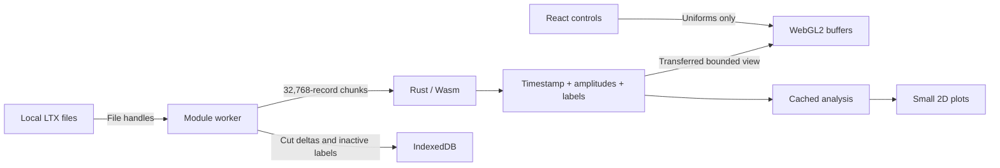

# Data flow, caches and bounded work

## Ownership

React owns control state and bounded display arrays, never the full waveform file. A worker owns opaque Rust engine pointers, population arrays, file references, cut sessions and analysis caches. Each cached tetrode has its own Wasm instance; eviction releases the engine and removes its instance reference, allowing its memory to be reclaimed instead of retaining a process-wide high-water arena.

The Rust crate is dependency-free. It decodes signed samples, computes peak-to-peak amplitude, retains timestamps/labels, counts groups, and applies polygon, raster-brush, waveform-gate, merge, swap and renumber operations. The worker validates format/count/range constraints before invoking the raw ABI. Allocation helpers accept byte buffers; addresses remain stable across Wasm memory growth, and JS typed-array views are reconstructed after operations that may allocate.

Position processing, histograms, occupancy and rate maps run in the same worker. UI updates cannot run large file or analysis loops on the React thread. Responses carry request IDs; React generation checks discard stale display results. New load requests cancel superseded chunk scans at the next asynchronous boundary. Mutations are serialised so files, labels and history cannot be edited concurrently.

## Population representation

For N spikes:

| Data                    | Representation                                                                | 9 million spikes            |
| ----------------------- | ----------------------------------------------------------------------------- | --------------------------- |
| Timestamps              | `u32[N]`, raw acquisition ticks                                               | 36 MB                       |
| Peak-to-peak amplitudes | `u8[N*4]`, signed-wave max−min                                                | 36 MB                       |
| Active cell labels      | `u16[N]`                                                                      | 18 MB                       |
| Waveform input          | 32,768 × 216 byte scratch chunk                                               | 7.08 MB                     |
| Waveform samples        | Up to 128 sampled records per initial cell, replenished for newly split cells | About 2.56 MB for 100 cells |

The input file itself is about 1.94 GB. It is held as a browser File reference and read with Blob slices. It is not copied into JS or Wasm as one buffer. File timestamps, amplitudes and record order are retained exactly. Raw ADC amplitudes are displayed without claiming calibrated microvolts.

A waveform threshold needs one channel/sample column that the compact amplitude representation cannot reconstruct. The first gate on a column reads the file in chunks and caches one signed byte per spike; two columns are retained per tetrode. This is explicit user-requested work, not hidden reprocessing on every split.

## Display and GPU

A default 250,000-point feature view transfers about 3.5 MB: 1 MB amplitudes, 1 MB normalised times, 0.5 MB labels, 1 MB indices. No millions-of-object JS model is built. Points are evenly spaced across the original index range. Counts and editing always use every spike; the sample is only a visual LOD.

One WebGL2 context draws six projections from one VAO/buffer set. Axis selection, time colouring, visible time range, point size, alpha and selected-cell isolation are uniforms. These settings neither reread files nor rebuild population features. Buffers are reused across renders; only changed labels are uploaded after edits. Up to four view buffer sets are cached, with least-recently-used eviction.

Waveforms use signed-byte integer textures and instanced line strips. The overview draws at most 12 cells per page using one context and viewports, avoiding the browser's context limit. Pinned comparisons store only PNG snapshots, not additional population arrays or live GPU contexts. WebGL context restoration recreates projection resources.

Full-file waveform density, all-spike point rendering and all-pair autocorrelation are intentionally not assumed necessary for interactive display. Their sampling is visible in the UI and documented in the feature inventory.

## Cut histories

Each `(file identity, cut identity)` has its own undo/redo metadata. Before an edit, one temporary label copy is taken. A sparse patch stores changed indices and before/after labels (8 bytes per changed spike); if that exceeds two compact label snapshots, the dense representation is used instead. The immutable patch is committed to IndexedDB before an edit is accepted. Storage failure restores the previous labels and counts.

Undo/redo reads one patch and applies it to the labels. It does not re-decode spikes. Redo branches are cleared on a new edit. Switching cuts writes the outgoing labels to IndexedDB and restores the incoming labels. There is no fixed history depth, but browser storage quota remains a practical bound. Inactive full labels are not kept in the worker's JS heap.

Workspace/session metadata is intentionally tab-local. IndexedDB holds patch payloads and inactive labels, but reloading does not reconstruct open File objects or the metadata stack. Export remains the durable interchange mechanism. Original files on disk are immutable to the app.

## Cache limits and invalidation

- Population cache: approximately 384 MiB target, evicting inactive tetrodes first. This is a retained-cache target, not a hard bound on browser/GPU/temporary memory. Wasm allocator high-water marks, edits, clones and GC can briefly increase memory.
- Positions: four processed variants keyed by file and LED/jump/smoothing settings.
- Analysis: up to 100 results keyed by cut identity, revision, cell, position variant and numeric bin/smoothing/window settings. An edit clears derived analysis; unchanged raw tetrode features and GPU geometry are retained.
- GPU: four bounded point views; render-only controls reuse buffers.
- Waveform gates: two compact sample columns per cached tetrode.

Rate-map colour ceilings only recolour an existing map. Position options reprocess position, not tetrode waveforms. Numeric map/window settings invalidate only their derived analysis. The worker's current implementation computes a selected-cell analysis bundle together; splitting that bundle into independent caches would further reduce work when changing only one analysis setting.

## Static hosting

Vite emits relative asset paths. Main-thread worker initialisation supplies the Wasm URL relative to the document base, so a worker under `/waveform/assets/` does not mistakenly fetch `/waveform/assets/wasm/`. Wasm is built by Cargo and copied to `public/wasm` before Vite builds. No thread-shared Wasm memory, SharedArrayBuffer, custom server, authentication service or cross-origin isolation header is required.
